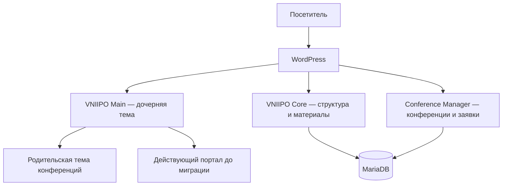

# Архитектура основного сайта

Выбрана единая установка WordPress с общей базой и редакторскими пользователями. На первом этапе отдельный рабочий портал сохраняется по внешней ссылке. На этапе миграции его данные переходят в ту же установку. Отдельный SPA/backend сейчас добавил бы второй контур редактирования и усложнил бы использование существующих форм.

## Границы компонентов

`vniipo-main` отвечает за общие шапку и подвал, главную, информационные страницы, поиск, публикации, 404, адаптивное меню и условное подключение конференционных стилей. Общие шаблоны используют стандартные WordPress API. Частные конференционные шаблоны наследуются из родительской темы согласно [иерархии WordPress](https://developer.wordpress.org/themes/classic-themes/basics/template-hierarchy/).

`vniipo-core` содержит единственный машиночитаемый реестр структуры `content/structure.json`, команду `wp vniipo scaffold`, типы материалов `vniipo_document`, `vniipo_faq`, `vniipo_banner`, общие функции разрешения ссылок и внутренние 301. Новости — стандартный тип `post`. Типы материалов находятся в плагине, чтобы сохраняться при смене темы; это соответствует [рекомендациям WordPress](https://developer.wordpress.org/plugins/post-types/registering-custom-post-types/).

`fyremezzonine-conference-manager` остаётся единственным владельцем `conference`, метаданных, прав, заявок, таблиц и жизненного цикла. Новый core не реализует дублирующую регистрацию и не переносит данные при активации.

В 0.3.0 core также владеет `vniipo_block`: редакторские информационные блоки, области размещения, порядок и привязка к странице. Они выводятся через слоты темы, Gutenberg и shortcode. Снимок oren.vniipo.ru хранится в JSON с локальными изображениями; отдельный ручной импорт сопоставляет source UID и проверяет контрольный хеш импортированного состояния перед обновлением. При активации плагина ничего не импортируется. Подробности — `content-management.md` и `source-sync.md`.

`vniipo-preview` — отдельный необязательный модуль показа. На действующем конференционном WordPress он применяет дочернюю тему только к запросам администратора под `/vniipo-preview/`, а структуру страниц выводит без сохранения в БД. Неактивный `vniipo-core` подгружается только внутри такого запроса. Публичные настройки `stylesheet`, `template`, `page_on_front` не изменяются. Установка и границы — `hosting-preview.md`.

## Создание структуры

Идентификатор `_vniipo_key` связывает страницу с реестром. Сначала создаются родители, затем дочерние страницы. Повторный запуск добавляет только отсутствующие страницы и пункты меню. Он не перезаписывает заголовки, содержимое, статусы и назначенное редактором меню. Конфликт URL, несколько записей с одним ключом или страница в корзине останавливают команду с ошибкой. Созданные до ошибки страницы остаются; повторный запуск безопасен после устранения конфликта.

Главная изменяется только по явному `--set-front-page`. Эта опция входит в bootstrap нового стенда, но её нельзя применять к рабочему сайту без миграционного плана. Добавление страниц в `structure.json` — управляемое изменение структуры, а не синхронизация с удалением отсутствующих страниц.

## Мультиязычность

В 0.4.0 подготовлены русский, английский и традиционный китайский. Необязательная зависимость Polylang 3.9.1 закреплена версией и SHA-256; без неё русская версия работает самостоятельно. Переведены 96 сообщений интерфейса, настроены отдельные языковые URL, hreflang и связи переводов. Созданы 16 черновиков основных страниц; они не публикуются при настройке. Источники синхронизации принадлежат только русским оригиналам, служебные source UID не копируются в переводы. Конференции остаются едиными русскими записями. Полная переводная редакция всех официальных материалов требует вычитки; порядок — `multilingual.md`.

## Среда и поставка

Локальный baseline: WordPress `7.0.2-php8.3-apache`, MariaDB `11.4.10`. Образы взяты из существующего контура старого проекта; перед production их нужно проверить и закрепить digest. WP-CLI использует `wordpress:cli-php8.3`, поэтому его фактическая версия фиксируется результатами проверки, а не считается неизменной.

Компоненты монтируются read-only; данные WordPress и MariaDB находятся в именованных томах отдельного compose-проекта. Порт 8088 слушает `127.0.0.1`. WordPress core, БД, uploads и секреты не версионируются. Исходники и история изменений находятся в GitHub, пакет компонентов создаётся без npm-зависимостей.

Проект пока не задаёт production-домен, TLS, почтовую доставку, систему подписки и инфраструктуру резервного копирования. Они выбираются после подтверждения хостинга. Кэш, CDN и внешний поиск добавляются по измерениям, а не как обязательные сервисы первой версии.
